  <picture>
    <source media="(prefers-color-scheme: dark) and (max-width: 600px)" srcset="assets/dark/m-hero.svg">
    <source media="(max-width: 600px)" srcset="assets/light/m-hero.svg">
    <source media="(prefers-color-scheme: dark)" srcset="assets/dark/hero.svg">
    
  </picture>

  <picture>
    <source media="(prefers-color-scheme: dark) and (max-width: 600px)" srcset="assets/dark/m-h-about.svg">
    <source media="(max-width: 600px)" srcset="assets/light/m-h-about.svg">
    <source media="(prefers-color-scheme: dark)" srcset="assets/dark/h-about.svg">
    
  </picture>

  <picture>
    <source media="(prefers-color-scheme: dark) and (max-width: 600px)" srcset="assets/dark/m-about.svg">
    <source media="(max-width: 600px)" srcset="assets/light/m-about.svg">
    <source media="(prefers-color-scheme: dark)" srcset="assets/dark/about.svg">
    
  </picture>

  <picture>
    <source media="(prefers-color-scheme: dark) and (max-width: 600px)" srcset="assets/dark/m-h-stack.svg">
    <source media="(max-width: 600px)" srcset="assets/light/m-h-stack.svg">
    <source media="(prefers-color-scheme: dark)" srcset="assets/dark/h-stack.svg">
    
  </picture>

  <picture>
    <source media="(prefers-color-scheme: dark) and (max-width: 600px)" srcset="assets/dark/m-stack.svg">
    <source media="(max-width: 600px)" srcset="assets/light/m-stack.svg">
    <source media="(prefers-color-scheme: dark)" srcset="assets/dark/stack.svg">
    
  </picture>

  <picture>
    <source media="(prefers-color-scheme: dark) and (max-width: 600px)" srcset="assets/dark/m-chips.svg">
    <source media="(max-width: 600px)" srcset="assets/light/m-chips.svg">
    <source media="(prefers-color-scheme: dark)" srcset="assets/dark/chips.svg">
    
  </picture>

  <picture>
    <source media="(prefers-color-scheme: dark) and (max-width: 600px)" srcset="assets/dark/m-h-research.svg">
    <source media="(max-width: 600px)" srcset="assets/light/m-h-research.svg">
    <source media="(prefers-color-scheme: dark)" srcset="assets/dark/h-research.svg">
    
  </picture>

  <picture>
    <source media="(prefers-color-scheme: dark) and (max-width: 600px)" srcset="assets/dark/m-research.svg">
    <source media="(max-width: 600px)" srcset="assets/light/m-research.svg">
    <source media="(prefers-color-scheme: dark)" srcset="assets/dark/research.svg">
    
  </picture>

  <picture>
    <source media="(prefers-color-scheme: dark) and (max-width: 600px)" srcset="assets/dark/m-h-more.svg">
    <source media="(max-width: 600px)" srcset="assets/light/m-h-more.svg">
    <source media="(prefers-color-scheme: dark)" srcset="assets/dark/h-more.svg">
    
  </picture>

  <picture>
    <source media="(prefers-color-scheme: dark) and (max-width: 600px)" srcset="assets/dark/m-more.svg">
    <source media="(max-width: 600px)" srcset="assets/light/m-more.svg">
    <source media="(prefers-color-scheme: dark)" srcset="assets/dark/more.svg">
    
  </picture>

  <picture>
    <source media="(prefers-color-scheme: dark) and (max-width: 600px)" srcset="assets/dark/m-quote.svg">
    <source media="(max-width: 600px)" srcset="assets/light/m-quote.svg">
    <source media="(prefers-color-scheme: dark)" srcset="assets/dark/quote.svg">
    
  </picture>

  <picture>
    <source media="(prefers-color-scheme: dark) and (max-width: 600px)" srcset="assets/dark/m-h-connect.svg">
    <source media="(max-width: 600px)" srcset="assets/light/m-h-connect.svg">
    <source media="(prefers-color-scheme: dark)" srcset="assets/dark/h-connect.svg">
    
  </picture>

  <a href="https://instagram.com/dr.usmanzade"><picture>
    <source media="(prefers-color-scheme: dark) and (max-width: 600px)" srcset="assets/dark/m-link-instagram.svg">
    <source media="(max-width: 600px)" srcset="assets/light/m-link-instagram.svg">
    <source media="(prefers-color-scheme: dark)" srcset="assets/dark/link-instagram.svg">
    
  </picture></a>
  <a href="https://t.me/dr_usmanovm"><picture>
    <source media="(prefers-color-scheme: dark) and (max-width: 600px)" srcset="assets/dark/m-link-telegram.svg">
    <source media="(max-width: 600px)" srcset="assets/light/m-link-telegram.svg">
    <source media="(prefers-color-scheme: dark)" srcset="assets/dark/link-telegram.svg">
    
  </picture></a>

  <picture>
    <source media="(prefers-color-scheme: dark) and (max-width: 600px)" srcset="assets/dark/m-footer.svg">
    <source media="(max-width: 600px)" srcset="assets/light/m-footer.svg">
    <source media="(prefers-color-scheme: dark)" srcset="assets/dark/footer.svg">
    
  </picture>

